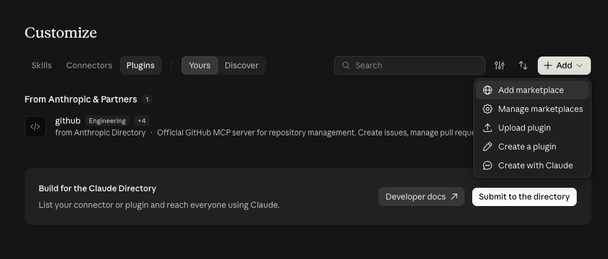
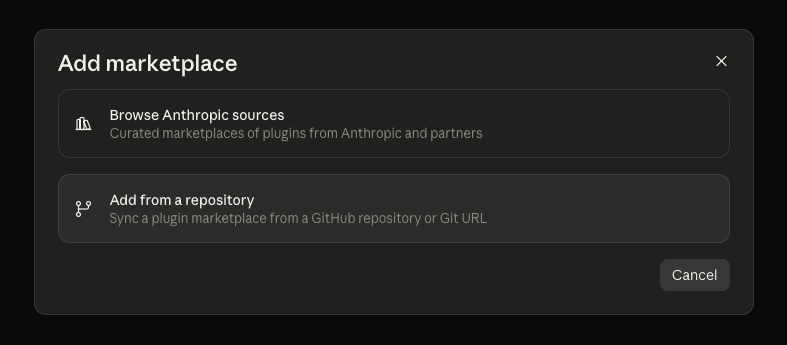
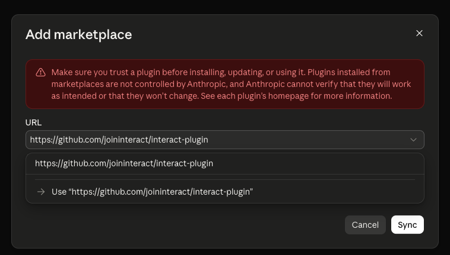
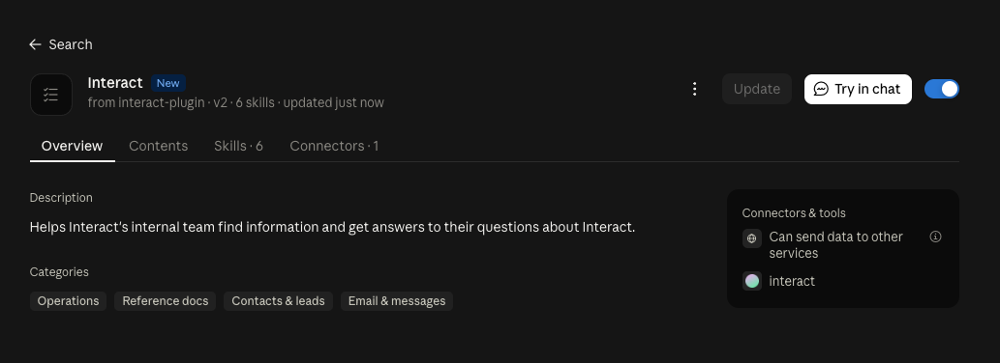
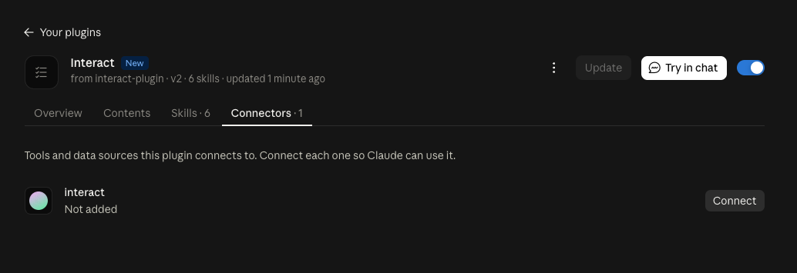
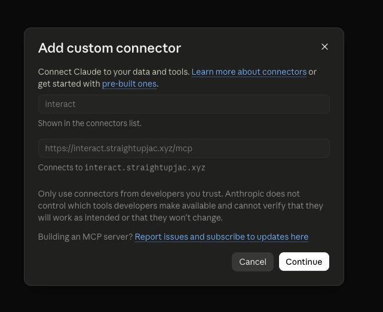
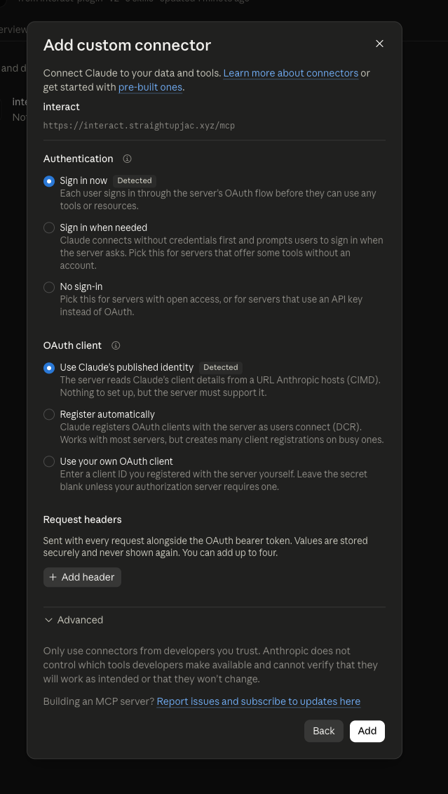
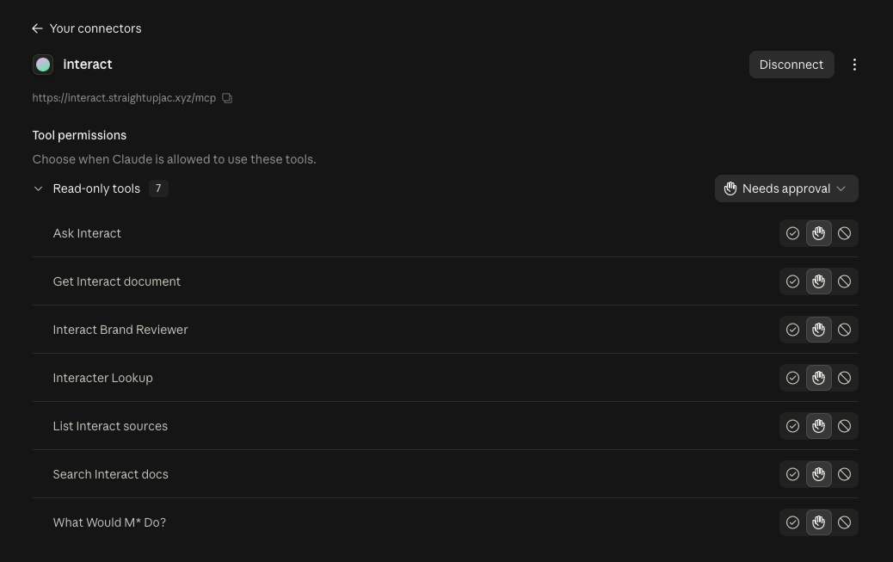

# Interact plugin for Claude

Helps Interact's internal team (fellowship, Studio, chapter leads, and college directors) find information and get answers to their questions about Interact, straight from Interact's own documents.

It connects Claude to Interact's knowledge base, so questions about programs, retreats, colleges, members, and how things work get answers grounded in Interact's records, with links to the sources.

**You need an email on Interact's allowlist.** Ask an Interact admin to add you before you start.

## How to use it

### In Claude (claude.ai or the Claude desktop app)

1. **Open the plugins page.** Go to **Customize** and select the **Plugins** tab. Click **Add** (top right), then **Add marketplace**.

   

2. **Choose "Add from a repository".**

   

3. **Paste the repository URL and sync.** Paste the URL below, select **Use "https://github.com/joininteract/interact-plugin"**, then click **Sync**.
   ```
   https://github.com/joininteract/interact-plugin
   ```
   Claude shows a standard warning about trusting plugins from outside Anthropic. That's expected for any marketplace you add yourself.

   

4. **Turn on the Interact plugin.** Open **Interact** (from interact-plugin) and switch on the toggle at the top right.

   

5. **Connect the Interact connector (required).** Turning on the plugin doesn't connect it, and the plugin can't answer anything until you do. If you skip this, Claude walks you through it the first time you ask.

   1. On the plugin page, open the **Connectors** tab. You'll see **interact** marked *Not added*. Click **Connect**.

      

   2. The **Add custom connector** form opens with the name (`interact`) and URL (`https://interact.straightupjac.xyz/mcp`) already filled in. Click **Continue**.

      

   3. Leave the detected settings as they are: **Authentication: Sign in now** and **OAuth client: Use Claude's published identity**. Don't add any headers. Click **Add**.

      

   4. Interact's sign-in page opens. Enter your allowlisted email, then the code it emails you.

   5. You'll land on the connector's page, listing Interact's seven tools. All of them are read-only. By default each one shows **Needs approval**, so Claude asks before each use. To skip those prompts, set **Read-only tools** to **Always allow**.

      

6. **Start asking.** Click **Try in chat**, or open a new chat, and ask anything about Interact. No special commands needed:
   - "What programs is Interact running this year?"
   - "Who is …? Which college are they in?"
   - "Is this email on-brand?" followed by your draft
   - "What would M\* do about…"

### In Claude Code

1. **Add and install the plugin:**
   ```
   /plugin marketplace add joininteract/interact-plugin
   /plugin install interact@interact
   ```
2. **Connect and sign in:** run `/interact:setup` and follow the steps. It opens Interact's sign-in page; enter your allowlisted email and the emailed code.
3. **Start asking**, in plain language or with a shortcut:

   | Shortcut | What it does |
   |---|---|
   | `/interact:ask <question>` | Answers questions about Interact, with sources |
   | `/interact:lookup <name or email>` | Looks up a member: their record first, then retreat and program history |
   | `/interact:brand-reviewer <draft>` | Interact Brand Reviewer: reviews comms (emails, announcements, invites) against Interact's brand |
   | `/interact:wwmd <situation>` | What would M\* do? Who is M? That's for you to figure out. |
   | `/interact:setup` | Checks your connection and helps you sign in |

4. **Stay up to date (optional):** `/plugin` → **Marketplaces** → **interact** → **Enable auto-update**.

### If something doesn't work

- **Claude says it can't connect after you sign in:** your email probably isn't on the allowlist yet. Ask an Interact admin to add the exact email you used.
- **Interact's answers don't show up:** check the plugin is connected (Connectors tab on claude.ai, or `/interact:setup` in Claude Code).
- **Still stuck:** ask in the Interact team channel.

## Data

Requests go to Interact's server, which searches Interact's indexed documents. Access is read-only, and the plugin stores nothing itself. Only users on the Interact allowlist can access data. Ask an Interact admin to add you.

## Maintainers

- The skills here are thin. The real logic (tools, instructions, documents) lives in the private `interact-mcp` server, so most changes need no plugin update.
- `plugin.json` has no `version`, so Claude Code users track the latest commit.
- The server URL appears in two places: `plugins/interact/.mcp.json` and `skills/setup/SKILL.md`. Update both when moving to mcp.joininteract.com.
- Validate before pushing: `claude plugin validate .`
